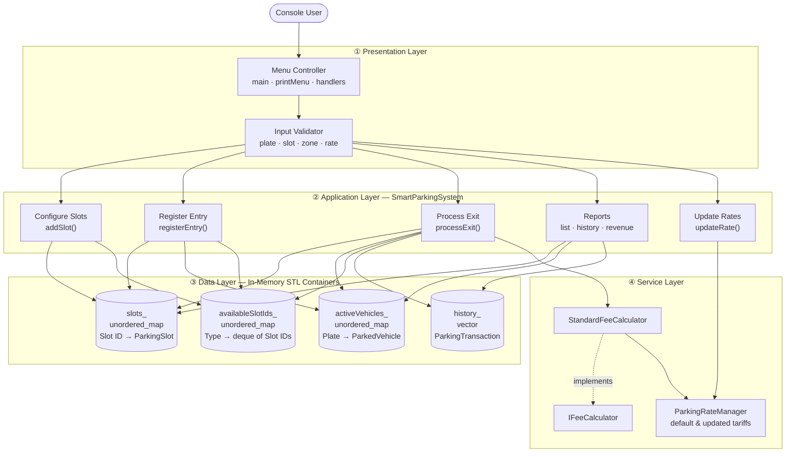

# Smart Parking System — Architecture Diagram

Paste the block below into [Mermaid Live Editor](https://mermaid.live) or any Mermaid-supported viewer.

## Layer summary

| Layer | Components | Role |
|-------|------------|------|
| ① Presentation | Menu Controller, Input Validator | User input, menu navigation, validation |
| ② Application | SmartParkingSystem operations | Business rules: slots, entry, exit, reports, rates |
| ③ Data | 4 STL containers | Fast in-memory storage — no database |
| ④ Service | Rate manager + fee calculator | Tariffs and parking fee logic (polymorphism) |

## Data flow (quick read)

1. **User** picks a menu option → **Input Validator** checks input.
2. **SmartParkingSystem** runs the matching operation.
3. Operations **read/write** the in-memory maps and vector.
4. On **exit**, **StandardFeeCalculator** uses **ParkingRateManager** rates to compute the fee, then saves a **ParkingTransaction** to history.
