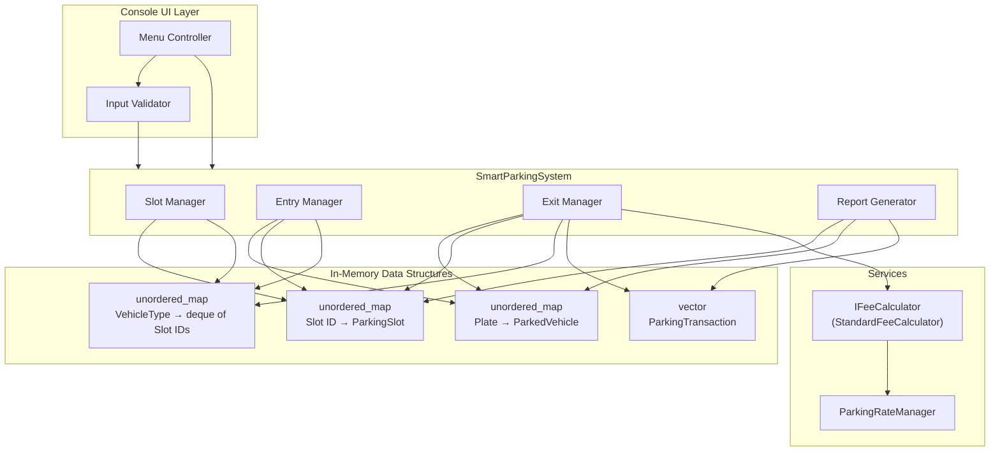

# Kigali Smart Parking Management System

A console-based Smart Parking Management System implemented in a **single C++ file** using in-memory data structures only.

## Compile & Run

```bash
g++ -std=c++17 -Wall -Wextra -o smart_parking smart_parking_system.cpp
./smart_parking
```

**Windows (PowerShell):**
```powershell
g++ -std=c++17 -Wall -Wextra -o smart_parking.exe smart_parking_system.cpp
.\smart_parking.exe
```

## Default Parking Rates

| Vehicle Type | Rate (RWF/hour) |
|--------------|-----------------|
| Motorcycle   | 500             |
| Car          | 1,000           |
| Truck        | 2,000           |

- Fees are calculated **only on exit**
- **Partial hours count as full hours** (e.g. 15 min → 1 hour, 1h 20m → 2 hours)
- Rate updates apply to **future exits only**; completed history keeps the rate charged at exit time

## Menu Options

| # | Action |
|---|--------|
| 1 | Configure a new parking slot (ID, vehicle type, zone) |
| 2 | View all parking slots |
| 3 | Register vehicle entry (plate, type, entry time) |
| 4 | Process vehicle exit (plate, exit time, fee calculation) |
| 5 | Update hourly parking rate for a vehicle type |
| 6 | View current rates |
| 7 | View available slots |
| 8 | View currently parked vehicles |
| 9 | View completed parking history |
| 10 | View daily revenue |
| 11 | Load demo slots for quick testing |
| 0 | Exit |

## Quick Test Walkthrough

1. Run the program and choose **11** to load demo slots.
2. Choose **3** → register `RAB123A` as a **Car** (use current time).
3. Choose **8** → confirm the vehicle is parked.
4. Choose **4** → exit `RAB123A` (use current time or a later time).
5. Choose **9** → view the completed transaction with fee.
6. Choose **5** → update Car rate to `1500`, then exit another car to see the new rate applied.
7. Choose **10** → view today's revenue.

**Datetime format:** `YYYY-MM-DD HH:MM` (e.g. `2026-06-10 14:30`)

## Data Structures Used

| Structure | Purpose | Why |
|-----------|---------|-----|
| `unordered_map<string, ParkingSlot>` | Slot storage | O(1) lookup/update by Slot ID |
| `unordered_map<string, ParkedVehicle>` | Active vehicles | O(1) duplicate-entry check & exit lookup |
| `unordered_map<VehicleType, deque<string>>` | Available slots per type | O(1) slot allocation |
| `vector<ParkingTransaction>` | Completed history | Efficient append & report traversal |

## Architecture Diagram



## OOP Design

- **Encapsulation:** Domain classes (`ParkingSlot`, `ParkedVehicle`, `ParkingTransaction`) hide internal state
- **Abstraction:** `IFeeCalculator` defines the fee contract
- **Polymorphism:** `StandardFeeCalculator` implements fee logic via virtual methods
- **Separation of concerns:** Validation, rates, business logic, and UI are in distinct classes
